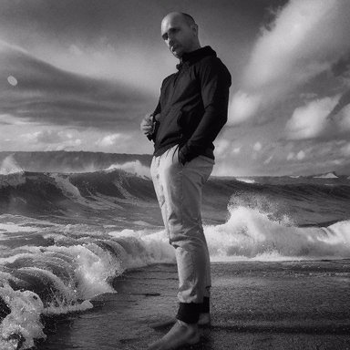
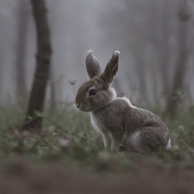
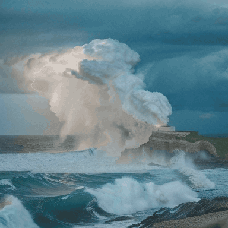
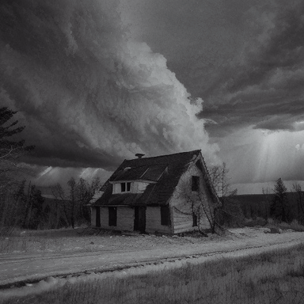
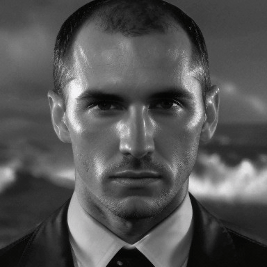
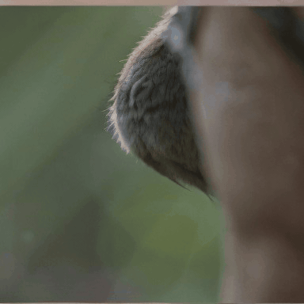
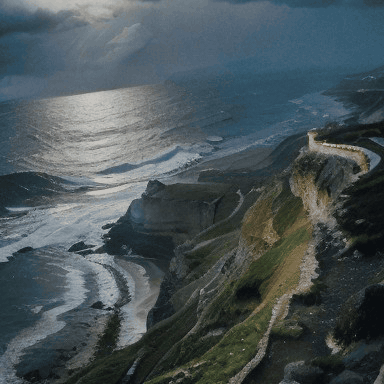
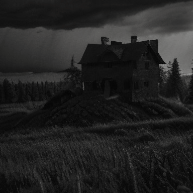
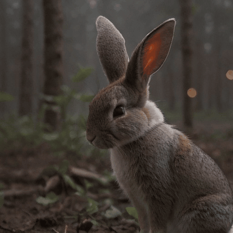
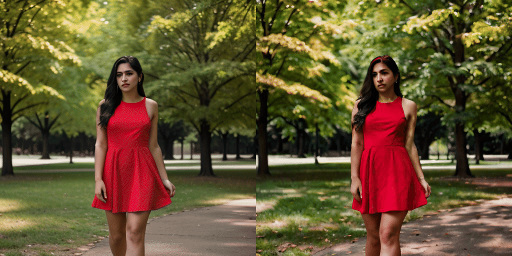

# AnimateDiff (SD 1.5 and SDXL beta)

AnimateDiff adds motion to a frozen Stable Diffusion checkpoint by injecting
temporal-attention modules into the UNet. The base model, VAE, and text
encoder are unchanged; only the motion module produces the temporal residual
that turns a batch of independent frames into a coherent animation. Native
support currently covers the established SD 1.5 modules and the experimental
`mm_sdxl_v10_beta` SDXL topology. Reference: Guo et al., "AnimateDiff: Animate Your
Personalized Text-to-Image Diffusion Models without Specific Tuning"
(https://arxiv.org/abs/2307.04725).

## Download weights

- Motion module (v3, recommended)
    - fp16 safetensors: https://huggingface.co/conrevo/AnimateDiff-A1111/resolve/main/motion_module/mm_sd15_v3.safetensors
    - original checkpoint: https://huggingface.co/guoyww/animatediff/resolve/main/v3_sd15_mm.ckpt
- SD 1.5 base model
    - any SD 1.5 checkpoint works. `realisticVisionV60B1` and `toonyou_beta3`
      are the ones used in guoyww's reference configs.
- Domain Adapter LoRA (optional, v3 only, sharpens the base UNet's output
    toward the motion module's trained distribution)
    - ckpt: https://huggingface.co/guoyww/animatediff/resolve/main/v3_sd15_adapter.ckpt
    - place under your `--lora-model-dir` and reference in the prompt as
      `<lora:v3_sd15_adapter:1.0>`.

### AnimateDiff-Lightning

The native loader also recognizes ByteDance's Diffusers-format motion adapter
layout. For the 4-step adapter, download:

- `animatediff_lightning_4step_diffusers.safetensors`:
  https://huggingface.co/ByteDance/AnimateDiff-Lightning/resolve/main/animatediff_lightning_4step_diffusers.safetensors

Pass the file through the same `--motion-module` option used by the original
AnimateDiff modules. Pair it with an SD 1.5 base checkpoint and the scheduler
settings recommended by the AnimateDiff-Lightning model card; this native
change covers the adapter tensor layout, not a replacement scheduler.

The motion module loads alongside the base UNet via `--motion-module`. The
SDXL beta module is approximately 238 MB on disk and is not a standalone
diffusion model; it must be paired with an SDXL base checkpoint. A 16-frame
SDXL generation can require roughly 13 GB of VRAM before backend splitting or
parameter offload is applied.

For SDXL beta, use `mm_sdxl_v10_beta.ckpt` with an SDXL base checkpoint. Its
three-level UNet uses two temporal modules per down block and three per up
block, with no temporal middle block. The native loader detects this topology
from the motion-module tensors and preserves multi-device backend assignments.

## Motion module versions

Per [animatediff.net/models](https://animatediff.net/models):

| Module              | Base | Native res | Character |
|---------------------|------|------------|-----------|
| `mm_sd_v14.ckpt`    | 1.5  | 256x256    | earliest, more jittery |
| `mm_sd_v15.ckpt`    | 1.5  | 256x256    | improved stability over v1.4 |
| `mm_sd_v15_v2.ckpt` | 1.5  | 384x384    | significantly better motion dynamics |
| `v3_sd15_mm.ckpt`   | 1.5  | 512x512    | smoothest, highest quality; pairs with a Domain Adapter LoRA |
| `mm_sdxl_v10_beta`  | SDXL | 512x512    | experimental beta; use with an SDXL base checkpoint |

Match your `-H -W` to the module's native resolution for best results. v3 is
trained at 512x512 - going smaller (e.g. 384x384) still works but the motion
character is closer to v2.

## Examples

Generate an 8-frame animation at 512x512, seed 42, 20 steps. The sampler /
scheduler / CFG values below match what mm_sd15_v3 was trained with; using
SD 1.5 defaults (euler_a, low CFG) produces noise-like output.

```
.\bin\Release\sd-cli.exe -M vid_gen \
    --model ..\models\checkpoints\realisticVisionV60B1.safetensors \
    --motion-module ..\models\animatediff\mm_sd15_v3.safetensors \
    --offload-to-cpu --diffusion-fa \
    -p "a red apple on a wooden table" \
    --cfg-scale 8.0 --sampling-method euler --scheduler discrete \
    -H 512 -W 512 --video-frames 8 --fps 8 --steps 20 -s 42 \
    -o out.avi
```

Generate at the motion module's native 16-frame context (recommended for
best temporal quality). Needs more VRAM at 512x512, so drop to 384x384 or
use layer streaming:

```
.\bin\Release\sd-cli.exe -M vid_gen \
    --model ..\models\checkpoints\realisticVisionV60B1.safetensors \
    --motion-module ..\models\animatediff\mm_sd15_v3.safetensors \
    --offload-to-cpu --diffusion-fa \
    -p "photo of coastline, rocks, storm weather, wind, waves, lightning" \
    --cfg-scale 8.0 --sampling-method euler --scheduler discrete \
    -H 384 -W 384 --video-frames 16 --fps 8 --steps 20 -s 42 \
    -o out.avi
```

Low-VRAM streaming (verified with a 2 GiB cap on RTX 3060):

```
.\bin\Release\sd-cli.exe -M vid_gen \
    --model ..\models\checkpoints\realisticVisionV60B1.safetensors \
    --motion-module ..\models\animatediff\mm_sd15_v3.safetensors \
    --max-vram 2.0 --stream-layers --diffusion-fa \
    -p "photo of coastline, rocks, storm weather, wind, waves, lightning" \
    --cfg-scale 8.0 --sampling-method euler --scheduler discrete \
    -H 384 -W 384 --video-frames 8 --fps 8 --steps 20 -s 42 \
    -o out.avi
```

## Reference-quality reproduction

Using guoyww's official reference configs on this impl (RealisticVision v6.0
base + `mm_sd15_v3` or `mm_sd_v15_v2` + native resolution + 16 frames + euler
+ 25 steps + CFG 8 + linear beta schedule) reproduces the reference
AnimateDiff output style.

### v3 (512x512, `mm_sd15_v3`)

| Prompt                                | Sample |
|---------------------------------------|--------|
| B&W man on stormy coastline           |     |
| Close-up rabbit macro shot            |  |
| Coastline, storm, waves, lightning    |   |
| Old house, storm, forest, night       |   |

### v2 (384x384, `mm_sd_v15_v2.ckpt`)

| Prompt                                | Sample |
|---------------------------------------|--------|
| B&W man on stormy coastline           |     |
| Close-up rabbit macro shot            |  |
| Coastline, storm, waves, lightning    |   |
| Old house, storm, forest, night       |   |

Motion is strong for scenes with motion cues in the prompt (storm/waves/wind)
and subtle for static subjects (close-up macro), matching reference behavior.
v2 has an additional motion module at the UNet middle block that v3 dropped;
this impl auto-detects the topology from the checkpoint.

### v3 + Domain Adapter LoRA

Attaching the `v3_sd15_adapter` LoRA sharpens the base UNet output toward
the training distribution the motion module was fine-tuned against. Same
prompt, seed, config as above:



Individual fur strands, glowing inner-ear, and richer forest detail become
visible compared to the no-LoRA rendering.

```
sd-cli -M vid_gen --model realisticVisionV60B1.safetensors \
       --motion-module mm_sd15_v3.safetensors \
       --lora-model-dir ./loras \
       -p "close up photo of a rabbit ...<lora:v3_sd15_adapter:1.0>" ...
```

## img2video

Pass a pre-rendered image via `-i / --init-img` to animate FROM it. All N output frames start from the encoded init latent, then per-frame noise is added at `--strength`. Character identity, composition, and quality are anchored by the init image; the motion module adds subtle motion on top.

Left: init image rendered with `-M img_gen`. Right: 8-frame vid_gen output.



```
sd-cli -M img_gen ... -o init.png                  # any high-quality still
sd-cli -M vid_gen --motion-module mm_sd15_v3.safetensors \
    -i init.png --strength 0.75 \
    --cfg-scale 7.0 --sampling-method euler --scheduler karras \
    -H 512 -W 512 --video-frames 8 --steps 25 -s 42 \
    -p "..." -o out.avi
```

`--strength` controls how far the motion module is allowed to deviate from the init image (higher = more motion, lower = more static).

## Notes

### EasyCache and TeaCache

The Easy Diffusion Video panel and C++ generation page offer **Disabled (exact)**,
**EasyCache**, or **TeaCache**. Select one method; there is no combined mode.
Both methods are available during multi-frame SD1.5/SDXL AnimateDiff sampling.
Merely loading a motion module does not enable these caches for ordinary image
generation or single-frame AnimateDiff. SD2 remains outside this integration.

Cache settings travel through the Python video adapter to `sd_vid_gen_params_t.cache`
and the shared native sampling dispatcher. Each run owns its cache state; positive
and negative conditioning have separate residual entries across the complete
temporal UNet batch. Changing the UI after queueing does not change that task's
selected cache or motion module.

- **EasyCache** uses the existing input/output-change estimator to decide whether
  to reuse a condition's model-output residual.
- **TeaCache** uses the existing condition-boundary relative-L1 accumulation
  policy. On AnimateDiff it uses the identity mapping, not polynomial coefficients
  fitted to Wan or LTX. This is a native adaptation, not a port of a calibrated
  SD1.5/SDXL first-block TeaCache implementation.
- A blank threshold uses **0.20** for either method on AnimateDiff. Zero prevents
  reuse. Larger thresholds allow more approximate reuse and may change quality.
- The default range is **15–95%**. UI/Python values are percentages (0–100);
  the Python adapter sends fractions to the native API, so 1% is 0.01, not 1.0.
  EasyCache maps that range through the denoiser's sigma schedule; TeaCache uses
  sampling-step progress. They are not identical scheduling policies.

Native logs report `EasyCache enabled` or `TeaCache enabled`, followed by the
existing per-run skip/reuse summary. A selected cache may legitimately report
zero reuse. The CPU regression `animatediff-cache-test` exercises both policies
with synthetic four-frame tensors, conditioning isolation, run isolation, invalid
ranges, and unsupported-model gating. UI and adapter tests cover selection and
request forwarding. These tests do not establish generation quality or a speedup
on real motion-model weights; compare each cache against Disabled with the same
model, seed, sampler, and frame count before relying on it for a workload.

### Measured cache behavior (2026-10-25)

RTX 3060, CUDA/flash attention, SD1.5 plus the v1.5-v2 motion module,
256x256, eight frames, 20 steps, CFG 7, seed 42, discrete scheduler,
default cache threshold 0.20 and range 15-95%. Values below are the mean
of two warm HTTP generations after one excluded warm-up. These are small
diagnostic samples, not general performance or quality guarantees.

| Sampler | Disabled | EasyCache | TeaCache | Sampled peak VRAM |
|---|---:|---:|---:|---:|
| LCM | 25.96 s | 26.12 s | 26.11 s | 4366 MiB for all modes |
| Euler | 26.17 s | 13.70 s | 11.18 s | 4366 MiB for all modes |

LCM produced zero cache reuse in these runs. Its fresh noise at each step
can prevent the input-change policies from accepting reuse; selecting a cache
does not guarantee a speedup. Euler's EasyCache runs skipped 10 of 20 steps;
TeaCache reused 24 of 40 conditioning evaluations. Cached output is approximate;
this test does not establish perceptual or temporal quality equivalence.

Keep the requested **Inference Steps** value when creating an AnimateDiff task.
Dropping it silently selects the backend default and changes how much work the
task performs. The shared step control remains available for AnimateDiff.

Matched pre-deployment/current-backend still-image checks did not reproduce a
five-second regression: SD1.5 at 896x960, eight LCM steps averaged 13.63/13.67 s;
SDXL at 512x512, eight LCM steps averaged 3.71/3.66 s. Sampled peak VRAM was
2660 MiB and 7272 MiB respectively, unchanged between builds. Other models,
settings, and UI/plugin overhead remain outside those comparisons.

### Other behavior

- The motion module was trained at `video_length=16`. Running with
  `--video-frames 16` gives the best coherence; F=8 works but shows a shorter
  motion arc. Frame counts up to 32 are supported by the positional encoding
  but exceed the trained regime and produce more static output.
- At `--video-frames 1` the motion module is skipped entirely and the output
  is bit-identical to `-M img_gen`. This avoids the single-token
  temporal-attention degeneracy that would otherwise emit an untrained-magnitude
  residual on a single-frame sample.
- The base UNet is frozen, so character identity and style follow the SD 1.5
  checkpoint you pass to `--model`. LoRAs and prompt weighting attach to the
  base model in the usual way.
- No mid_block motion module in v3. `mm_sdxl_v10_beta` uses the three-level
  SDXL UNet topology and the same `--motion-module` option. The native
  implementation supports its two-down-module/three-up-module temporal
  layout, but it remains an experimental beta module and should be tested at
  512x512 before increasing the frame count or resolution.
- Output is written as MJPEG AVI. Use `--fps` to set playback speed.
